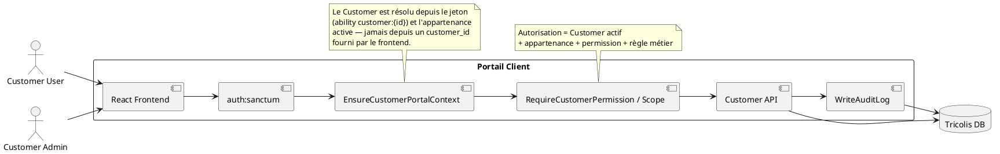
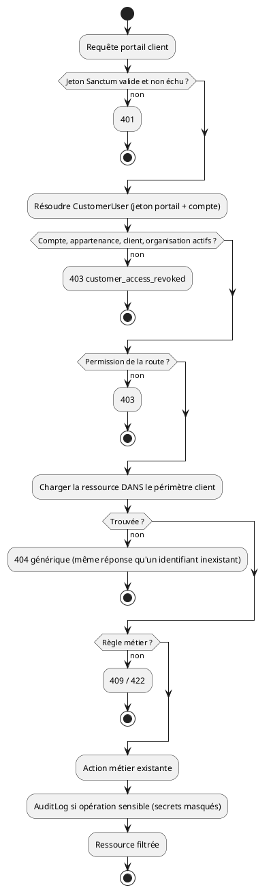
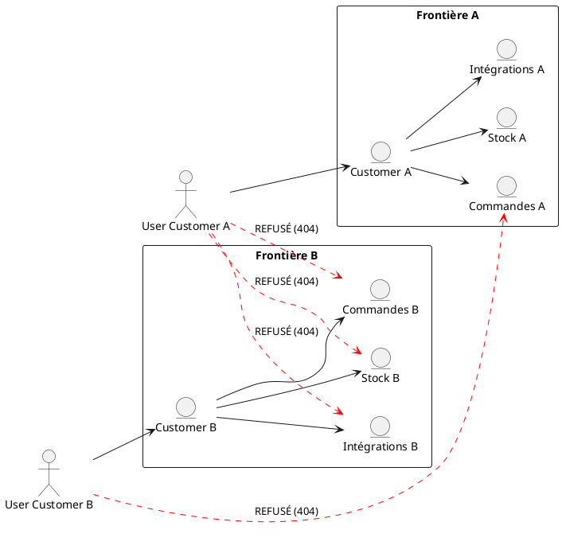

# Sécurité du portail client

Le portail est un **périmètre externe autonome** :

```text
Utilisateur authentifié → CustomerUser → Customer → Organization
```

Aucune opération ne franchit cette frontière sans autorisation explicite. Le
principe appliqué partout : *le contexte client n'est jamais pris au navigateur ;
l'identité et le client sont résolus côté serveur, chaque ressource est autorisée,
seul le nécessaire est exposé, et les changements sensibles sont audités sans
secret.*

Documents liés : [matrice d'accès](access-matrix.md) ·
[matrice des routes](security-route-matrix.md) ·
[protection des données](data-protection.md) ·
[décisions de conservation](retention-decisions.md).

## 1. Architecture







## 2. Contexte client (`CurrentCustomerContext`)

Un seul mécanisme, existant depuis la Phase 1 :

- le jeton du portail porte les abilities `customer-portal` et `customer:{id}` ;
- `EnsureCustomerPortalContext` vérifie à **chaque requête** : compte actif
  (`User.status`), appartenance active (`CustomerUser.status`), client actif
  (`Customer.status`) et, depuis la Phase 7, organisation ni `suspended` ni `closed` ;
- `CurrentCustomerContext` expose ensuite `user`, `membership`, `customer`,
  `organizationId` et les permissions effectives (`customer.*` uniquement, bornées
  par les modules ouverts au client).

Un jeton du portail est refusé sur toute route du back-office
(`RejectCustomerPortalToken`), un jeton interne sur toute route du portail.

## 3. Authentification

| Élément | Règle |
|---|---|
| Mécanisme | jetons Sanctum (Bearer), pas de cookie de session : pas de CSRF à gérer |
| Durée de vie | `CUSTOMER_PORTAL_TOKEN_TTL_MINUTES`, **720 min par défaut** (Phase 7) |
| Expiration | refusée par Sanctum (401) ; le frontend efface la session et revient à la connexion |
| Purge | `sanctum:prune-expired --hours=24`, quotidienne |
| Désactivation | les jetons du membre sont supprimés ; un compte/client/organisation fermé est refusé à la requête suivante |
| Déconnexion | supprime le jeton de la requête |
| Mots de passe | hash Laravel (`Hash::make`), jamais rendus, jamais audités ; invitation et réinitialisation par lien à usage unique |
| Jeton dans l'URL | jamais ; le lien public utilise son propre jeton, distinct |
| Stockage navigateur | `localStorage` (mécanisme existant, non migré en Phase 7) ; compensé par l'expiration et l'absence de tout script tiers |

## 4. RBAC et anti-escalade

- Permissions effectives = permissions `customer.*` des rôles de portée `customer`
  **de l'organisation du client**. Une permission interne portée par erreur par un
  rôle client est ignorée.
- Attribuer un rôle : `CustomerRoleGuard` n'accepte que les rôles portail de
  l'organisation, et `delegableFor` borne le résultat aux permissions de l'acteur.
- `ManagedMemberGuard` interdit d'agir sur soi-même ou sur le propriétaire.
- Les champs gérés par le serveur sont **refusés en 422** (`ServerControlledFields`) :
  client, organisation, statut, origine, numéro, remarque interne, prix et coûts
  d'une commande ; client, statut, administrateur, propriétaire, mot de passe et
  permissions d'un membre.

## 5. Isolation

Toute lecture part d'un mécanisme central de périmètre : `ResolvesCustomerOrder`,
`CustomerDocumentAccess`, `CustomerStockScope`, `CustomerIntegrationScope`,
`CustomerUserAccess`, requêtes de liste dédiées. Une ressource d'un autre client
répond **404, identique à celle d'un identifiant inexistant** (vérifié route par
route par `PortalCrossCustomerIsolationTest`). Un filtre `customerId` est refusé
(422). Un ULID n'est jamais considéré comme une protection.

## 6. Clés API client (`/api/v1/client/*`)

Empreinte SHA-256 seule en base, clé montrée une fois, rotation immédiate,
`allowedIps`, permissions par route, `lastUsedAt`, client déduit de la clé. Phase 7 :
client inactif/bloqué et organisation suspendue/fermée refusés ; plafond par clé ;
**plafond d'échecs par adresse IP** contre l'énumération de clés.

## 7. Lien public de suivi

Jeton aléatoire de 64 caractères, stocké haché ; identifiant de commande ou
référence refusés (même 404 générique) ; révocation et expiration ; projection
minimale sans identifiant, prix, adresse ni personne ; `noindex`, `no-store` ;
limite par adresse IP.

## 8. Fichiers

Téléchargements par endpoint autorisé uniquement (`CustomerDocumentAccess`),
`storagePath` jamais exposé, nom de fichier nettoyé, `nosniff`. Imports : extension
**et** type MIME détecté, taille plafonnée, nom de stockage généré (jeton), disque
privé, XML sans DTD, formules XLSX jamais calculées. Export CSV : cellules
commençant par `=`, `+`, `-` (non numérique), `@`, tabulation ou retour chariot
préfixées d'une apostrophe (`SpreadsheetSafe`).

## 9. Intégrations

Secrets chiffrés (`Crypt`), écriture seule, jamais rendus ni audités ; garde SSRF
(schéma, identifiants dans l'URL, port, `localhost`, link-local, métadonnées,
réseaux privés, IPv4 encapsulée, adresse résolue épinglée, redirections non
suivies) ; délais ; aucune commande shell. Détails : rapport de la Phase 6.

## 10. Audit et journaux

`AuditLog` est le seul audit (pas de table parallèle). `WriteAuditLog` passe toute
valeur par `SensitiveData` : mot de passe, secret, clé API et empreinte, contenu
chiffré, identifiants, `Authorization`, cookie, tout nom finissant par `token`
→ `[REDACTED]`, à toute profondeur. Le même filtre est branché sur les canaux de
journal fichier (`RedactSensitiveContext`). Le portail n'a aucune route d'audit.

## 11. Limites de débit

| Limiteur | Clé | Défaut | Variable |
|---|---|---|---|
| Connexion (Action) | adresse + e-mail | 5 / min | — |
| `customer-portal-login` | adresse IP | 30 / min | `CUSTOMER_PORTAL_LOGIN_RATE_LIMIT` |
| Mot de passe oublié, réinitialisation | adresse IP | 6 / min | — |
| Invitation / activation | adresse IP | 20 / 10 par min | — |
| `customer-portal` | compte | 300 / min | `CUSTOMER_PORTAL_RATE_LIMIT` |
| `customer-portal-import` | compte | 10 / min | `CUSTOMER_PORTAL_IMPORT_RATE_LIMIT` |
| `customer-portal-retry` | compte | 10 / min | `CUSTOMER_PORTAL_RETRY_RATE_LIMIT` |
| `public-tracking` | adresse IP | 60 / min | `PUBLIC_TRACKING_RATE_LIMIT` |
| `customer-api` | empreinte de clé | 60 / min | `CUSTOMER_API_RATE_LIMIT_PER_MINUTE` |
| échecs de clé API | adresse IP | 10 / min | `CUSTOMER_API_FAILED_ATTEMPTS_PER_MINUTE` |

Ces valeurs sont des **défauts techniques** (aucun chiffre métier fourni) ; la
réponse 429 est générique.

## 12. CORS et en-têtes HTTP

CORS : origines listées dans `config/cors.php`, sans joker, `supports_credentials`
à `false` (les jetons ne sont pas des cookies). En production, retirer les origines
`localhost`. Toute réponse `api/*` porte `X-Content-Type-Options: nosniff`,
`X-Frame-Options: DENY`, `Referrer-Policy: no-referrer`, une CSP
`default-src 'none'; frame-ancestors 'none'`, une `Permissions-Policy` minimale et,
en HTTPS, HSTS (`AddSecurityHeaders`).

**À configurer chez l'hébergeur des deux applications React** (servies hors
Laravel) : HTTPS obligatoire, HSTS, `nosniff`, `frame-ancestors 'none'`, et une CSP
qui autorise l'API, les tuiles OpenStreetMap utilisées par les cartes Leaflet et
rien d'autre — à établir avec les domaines réels.

## 13. Erreurs

JSON pour `api/*` ; `APP_DEBUG=false` en production (pas de trace, pas de SQL) ;
hors périmètre = 404 générique ; refus de contexte = 403 `customer_access_revoked`
sans détail ; champs secrets exclus des données renvoyées après une erreur
(`dontFlash`).

## 14. Dépendances et secrets (audit du 2026-10-01)

- `npm audit` : 0 vulnérabilité dans les deux frontends.
- `composer audit` : `league/commonmark` (DoS, XSS) et `league/flysystem` (contrôle de
  chemin) mis à jour en versions correctives. Reste `laravel/framework` < 13.30
  (XSS de la page de débogage, sévérité faible, sans effet avec `APP_DEBUG=false`) :
  montée mineure recommandée, à valider.
- Aucun secret réel versionné (`.env` non suivi ; seule une fausse clé de test).
- `.env` de développement : `LOG_VIEWER_ENABLED=true` — à laisser à `false` en
  production (défaut de `.env.example`).

## 15. Décisions à valider

1. Organisation `suspended`/`closed` → portail et API par clé fermés ; `pending` ouvert.
2. Durée de vie du jeton du portail : 720 minutes.
3. Plafonds de débit du tableau §11.
4. Montée mineure de `laravel/framework`.
5. CSP des applications React selon les domaines de production.
